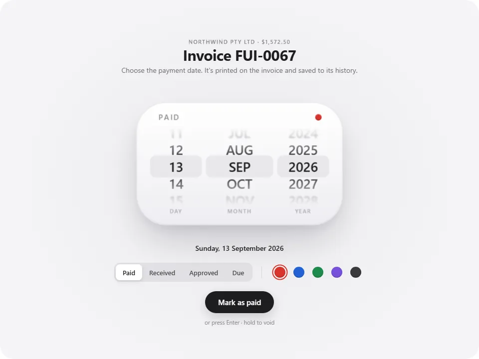

<p align="center">
  <picture>
    <source media="(prefers-color-scheme: dark)" srcset="docs/stamp-dark.webp" />
    
  </picture>
</p>

# Stamp

A date picker shaped like a desk stamp. Roll the date, press, and it prints on the invoice.

**Try it live at [feralui.dev/stamp](https://feralui.dev/stamp).**

- **Real 3D, not a video.** One CSS perspective camera tilts from the flat picker down to the desk and back up. The stamp is built from flat faces, and the invoice is real HTML lying on the desk.
- **A real date picker.** Day, month and year wheels you can drag, fling, scroll, tap or move with the arrow keys. Pick a short month and the day rolls back to its last real day.
- **No two prints match.** The ink speckle and the wobbly edges come from SVG noise with a new seed on every press.
- **Four statuses, five inks.** Paid, Received, Approved or Due, in red, blue, green, violet or graphite. Hold the button to void the invoice.
- **Knows when to skip the camera.** The camera only moves when the whole stage fits on screen. With reduced motion, on Enter, or with `motion="quick"`, it is a short dip and print instead. Undo stays one tap away.
- **Optional sound.** The wheel ticks, the thump and the chime are made with Web Audio, so there are no audio files.

## Quick start

Needs Node 20.19+ or 22.12+.

```bash
git clone https://github.com/mortspace/stamp
cd stamp
npm install
npm run dev
```

Open http://localhost:5173 and press the stamp.

## Use it in your app

Stamp is one folder with two dependencies. Copy `src` into your project, say as `stamp`, then install them:

```bash
npm install motion torph
```

```tsx
import { Stamp } from './stamp'

export function Billing() {
  return (
    <Stamp
      sound
      onStamp={({ invoiceId, status, date }) => save(invoiceId, status, date)}
      onUndo={({ invoiceId }) => revert(invoiceId)}
    />
  )
}
```

It needs React 19, and it fills the width of its container. From 560px up it draws a 960 by 720 stage scaled to fit. Below that it switches to a phone layout at true size, so every button stays at least 44px. In Next.js, render it from a client component.

## Props

| Prop            | Default           | What it does                                                                                                         |
| --------------- | ----------------- | -------------------------------------------------------------------------------------------------------------------- |
| `invoices`      | three sample ones | The invoices to stamp, in order. **Next invoice** moves to the next one.                                             |
| `issuer`        | FeralUI Studio    | Who the invoice is from: `name`, `logo`, `details`, `payment` and `website`.                                         |
| `motion`        | `'auto'`          | `'auto'` moves the camera on the first stamp only, `'cinematic'` on every stamp, `'quick'` never.                    |
| `sound`         | `false`           | Turns the sounds on.                                                                                                 |
| `timing`        | `STAMP_TIMING`    | `tilt`, `press`, `liftAway` and `rise` in seconds, plus the spring `bounce` (0 is none). Missing keys keep defaults. |
| `defaultDate`   | today             | The date the wheels start on.                                                                                        |
| `defaultStatus` | `'paid'`          | `'paid'`, `'received'`, `'approved'` or `'due'`.                                                                     |
| `defaultInk`    | `'red'`           | `'red'`, `'blue'`, `'green'`, `'violet'` or `'graphite'`.                                                            |
| `onStamp`       |                   | Called as the print lands, with `{ invoiceId, status, date, ink }`.                                                  |
| `onUndo`        |                   | Called with the same object when a stamp is undone.                                                                  |
| `className`     |                   | Added to the root element.                                                                                           |

An invoice looks like this:

```ts
{
  id: 'FUI-0067',
  client: 'Northwind Pty Ltd',
  total: '$1,572.50',
  issued: '01/09/2026',
  due: '15/09/2026',
  lines: [
    { description: 'Component design', quantity: '12.00', unitPrice: '$85/hour', total: '$1,020.00' },
  ],
}
```

## Keys

| Key                                   | What it does                                             |
| ------------------------------------- | -------------------------------------------------------- |
| Arrows, Page Up, Page Down, Home, End | Roll the focused wheel                                   |
| Enter                                 | Stamp straight away, without the camera move             |
| Escape                                | Skip the camera move, or carry on once the print is down |

## How it works

- **One camera.** `camera.ts` defines three pinhole cameras: the flat picker, the desk and the finished invoice. One value runs from 0 to 2 and the camera blends between them. It becomes a CSS `perspective` and one transform on a `preserve-3d` element, so the whole scene moves as one.
- **Written once per frame.** The camera, the stamp and its shadows are motion values, written straight to the DOM in a single frame callback in `useScene.ts`. React only renders when the phase changes.
- **The stamp body.** The side walls are a rounded rectangle cut into flat strips, each shaded by its angle to a fixed light. The live picker is the top face.
- **Shadows.** Two pre-blurred layers that crossfade as the stamp rises and falls. Nothing animates a blur.
- **Wheels without native scrolling.** Chromium doesn't reliably send wheel or touch scrolls to scrollers inside a 3D scene, so each wheel is a spring driven from script.
- **A sharp ending.** Chrome keeps a 3D layer at the resolution it had while moving, which leaves small text soft. Once the camera lands, a flat copy of the invoice takes over in exactly the same spot.
- **Download PDF.** The sheet is cloned into a hidden frame at A4 size and printed, so Save as PDF gives a real page.
- **Fonts.** The print uses Barlow Condensed and the invoice uses Poppins, loaded from Google Fonts on first render.

## Project layout

```
src/
  Stamp.tsx              the component: state, and the stamp, undo and rise sequences
  useScene.ts            motion values, and the per-frame camera, stamp and shadow writes
  useStageLayout.ts      wide or phone layout, and where the cameras aim
  useSequence.ts         cancellable animation steps
  camera.ts              the three cameras and how they blend
  world.ts               sizes in scene units, 48px to the centimetre
  timing.ts              durations and easing curves
  StampBlock.tsx         the 3D stamp body
  Wheel.tsx              one picker wheel
  StatusPicker.tsx       the status control
  InkPicker.tsx          the ink swatches
  HoldButton.tsx         the main button, with hold to void
  Toast.tsx              the Undo and Done bar on the desk
  Invoice.tsx            the invoice sheet
  PrintMark.tsx          the inked print
  sound.ts               the synthesised sounds
  printSheet.ts          Download PDF
  samples.tsx            the sample issuer and invoices
  stamp.css              every style, scoped under .stp
  index.ts               the public exports
demo/                    the page that npm run dev serves
```

## Credits

Made by [mortspace](https://x.com/SolutionB2u). Built with [Motion](https://motion.dev) and [Torph](https://torph.lochie.me), both MIT licensed.

## License

[MIT](LICENSE)
